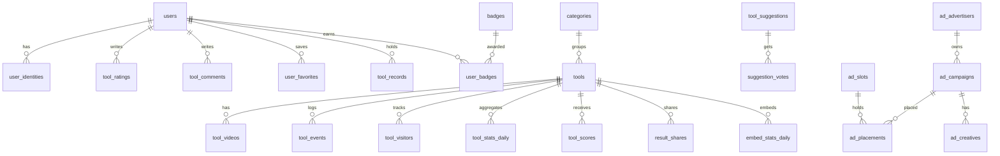

# سند الزامات محصول (PRD) — «هزار ابزارک»

## فهرست

1. خلاصه‌ی محصول
2. ارزش‌های محصول
3. مخاطبان و سناریوهای کلیدی
4. ماژول‌ها و بخش‌های محصول
5. تصمیم‌های ثبت‌شده‌ی محصولی
6. فرض‌ها، خارج از محدوده و پرسش‌های باز
7. استانداردهای پروژه
8. ریسک‌ها و راهکارها
9. واژه‌نامه
10. برنامه‌ی توسعه‌ی فازبندی‌شده (فاز ۱ تا ۱۴)

---

## ۱. خلاصه‌ی محصول

**هزار ابزارک** (`1000abzarak.ir`) مجموعه‌ای آنلاین از ابزارک‌ها، ویجت‌ها و ابزارهای کاربردی **فانتزی و سرگرم‌کننده** برای کاربران ایرانی و فارسی‌زبان است؛ مثل مبدل‌های فانتزی (مثلاً «سن اژدهایی من»)، ماشین‌حساب‌های فانتزی و ابزارهای کوچک خلاقانه. هر ابزارک در مرورگر و با جاوا اسکریپت اجرا می‌شود.

سایت با هدف رسیدن به **هزار ابزارک** ساخته می‌شود. ابزارک‌ها به‌مرور اضافه می‌شوند و معماری باید طوری باشد که **افزودن ابزارک جدید فقط ساختن یک پوشه‌ی تازه باشد** و هسته‌ی سایت تغییری نکند.

| مورد | توضیح |
|---|---|
| مخاطب | کاربران فارسی‌زبان (ایران)، عمدتاً موبایل |
| نوع محصول | وب‌سایت راست‌به‌چپ، موبایل‌اول، SEO‌محور |
| مدل درآمد | تبلیغات مستقیم و شبکه‌های واسط (مثل یکتانت) |
| استک | فرانت‌اند: HTML، CSS، JavaScript و فریم‌ورک Tailwind CSS؛ بک‌اند: PHP و Laravel؛ پایگاه داده‌ی سمت سرور: MySQL با اتصال از طریق PDO؛ ذخیره‌سازی سمت مرورگر در صورت نیاز با قابلیت‌های پایگاه داده‌ی مرورگر یا JSON |
| طراحی | UI Kit پیوست‌شده: فونت **بالو بهیجان ۲**، آیکن‌های **Phosphor**، تم **آب‌نباتی** |
| معیار موفقیت | کاربران فعال ماهانه (MAU) و تعداد بازدید |
| انتشار | یک نسخه‌ی کامل (با مایل‌استون‌های داخلی توسعه) |

### قابلیت‌های اصلی در یک نگاه

- ثبت‌نام اختیاری (موبایل، ایمیل، گوگل) و داشبورد آمار شخصی
- ثبت **بازدید** و **استفاده** هر ابزارک، با آمار عمومی (کل استفاده، کاربران یکتا، ستاره و نظر، برچسب «داغ‌ترین» و «تازه»)
- نظر و ستاره برای هر ابزارک (نظرها با تأیید مدیر منتشر می‌شوند)
- رکوردها و جدول برترین‌ها برای ابزارک‌های دارای رکورد
- اشتراک‌گذاری لینک، لینک نتیجه و کارت تصویری نتیجه برای استوری
- سیستم تبلیغات اسلات‌محور (مستقیم + شبکه‌ی واسط، با اولویت و جایگزین خودکار)
- امبد ابزارک در سایت دیگران، بدون تبلیغ و با لینک بازگشت به سایت
- علاقه‌مندی‌ها و تاریخچه، پیشنهاد ابزارک با رأی‌گیری، نشان‌ها و دستاوردها
- پنل مدیریت با نقش‌های جدا

---

## ۲. ارزش‌های محصول

این ارزش‌ها معیار تصمیم‌گیری در **همه‌ی فازهای توسعه** هستند و در هر فاز دوباره با معیار قابل‌سنجش آمده‌اند.

| # | ارزش | یعنی چه؟ | معیار قابل‌سنجش |
|---|---|---|---|
| ۱ | **ساده و شهودی** | کاربر بدون راهنما می‌فهمد چه کند؛ هر صفحه یک کار اصلی دارد | رسیدن از صفحه‌ی اصلی به ابزارک ≤ ۲ ضربه؛ اولین استفاده ≤ ۱۰ ثانیه |
| ۲ | **تجربه‌ی درجه‌یک** | سریع، روان، بی‌نقص روی موبایل و راست‌به‌چپ | LCP ≤ ۲٫۵ ثانیه، INP ≤ ۲۰۰ms، CLS ≤ ۰٫۱ (موبایل، صدک ۷۵) |
| ۳ | **فانتزی و شاد** | لحن، رنگ، متن‌ها و جزئیات UI حس بازی‌گونه و صمیمی بدهد | هر ابزارک از UI Kit و تم آب‌نباتی استفاده کند |
| ۴ | **افزودن آسان ابزارک** | ابزارک جدید = یک پوشه + یک فایل مشخصات؛ سایت خودش آن را می‌شناسد | افزودن ابزارک بدون ویرایش هیچ فایل هسته‌ای |
| ۵ | **شفافیت و اعتماد** | تبلیغ همیشه برچسب‌دار؛ آمار واقعی؛ نتیجه‌ها «سرگرمی» معرفی شوند | ۱۰۰٪ اسلات‌ها با برچسب «تبلیغات»؛ بدون آمار جعلی |
| ۶ | **درآمد بدون آزار** | تبلیغ نباید تجربه را خراب کند | CLS ناشی از تبلیغ = ۰؛ فاصله‌ی تبلیغ از دکمه‌های اصلی ≥ ۱۶px |
| ۷ | **رشد از راه اشتراک** | نتیجه‌ی بامزه باید به‌راحتی فرستاده شود | اشتراک نتیجه ≤ ۲ ضربه |

---

## ۳. مخاطبان و سناریوهای کلیدی

| نقش | هدف | سناریوی نمونه |
|---|---|---|
| **بازدیدکننده‌ی مهمان** | سرگرمی سریع بدون ثبت‌نام | از جستجوی گوگل وارد «سن اژدهایی» می‌شود، نتیجه می‌گیرد و برای دوستش می‌فرستد |
| **کاربر ثبت‌نام‌شده** | پیگیری آمار، رکورد، نظر | وارد می‌شود، رکورد بازی را ثبت می‌کند، در جدول برترین‌ها نامش را می‌بیند، نشان می‌گیرد |
| **مدیر سایت** | مدیریت محتوا و درآمد | تبلیغ مستقیم می‌گذارد، کد شبکه‌ی واسط را در اسلات قرار می‌دهد، نظرها را تأیید می‌کند |
| **صاحب سایت میزبان** | استفاده از ابزارک در سایت خودش | کد امبد را کپی می‌کند و ابزارک با لینک بازگشت به هزار ابزارک نمایش داده می‌شود |
| **توسعه‌دهنده‌ی ابزارک** (فعلاً خود مالک) | افزودن ابزارک | پوشه‌ی ابزارک را می‌سازد، پوش می‌کند، ابزارک خودکار در سایت ظاهر می‌شود |

---

## ۴. ماژول‌ها و بخش‌های محصول

| کد | ماژول | توضیح | فاز |
|---|---|---|---|
| M01 | **اسکلت و زیرساخت** | ساختار پروژه، CI/CD، محیط‌ها، کیفیت کد | ۱ |
| M02 | **معماری و پایگاه داده** | مدل داده، ERD، تصمیم‌های معماری (ADR) | ۲ |
| M03 | **سیستم طراحی (UI Kit)** | توکن‌ها، کامپوننت‌های Blade، چیدمان، راست‌به‌چپ، حالت تاریک | ۳ |
| M04 | **هویت و دسترسی** | ورود با موبایل/ایمیل/گوگل، نقش‌ها، ۲FA مدیر، پوسته‌ی پنل مدیریت | ۴ |
| M05 | **موتور ابزارک‌ها** | فایل مشخصات، اسکن خودکار، SDK، صفحه‌ی ابزارک، دسته‌ها، صفحه‌ی اصلی، جستجو، ویدیوها | ۵ |
| M06 | **ردیابی و آمار** | رویداد بازدید/استفاده، آمار عمومی، داشبورد کاربر، شاخص‌های مدیر (MAU و بازدید) | ۶ |
| M07 | **تعامل اجتماعی** | نظر (با تأیید مدیر)، ستاره، علاقه‌مندی‌ها، تاریخچه | ۷ |
| M08 | **رکوردها** | ثبت رکورد، جدول برترین‌ها، ضدتقلب | ۸ |
| M09 | **اشتراک‌گذاری** | لینک ابزارک، لینک نتیجه با پیش‌نمایش، کارت تصویری | ۹ |
| M10 | **تبلیغات** | اسلات، کمپین مستقیم، شبکه‌ی واسط، اولویت و جایگزین، گزارش | ۱۰ |
| M11 | **امبد** | iframe از دامنه‌ی خودمان، آمار امبد، لینک بازگشت | ۱۱ |
| M12 | **ترغیب و مشارکت** | نشان‌ها و دستاوردها، پیشنهاد ابزارک و رأی‌گیری | ۱۲ |
| M13 | **کیفیت و سخت‌سازی** | سئو، عملکرد، امنیت، دسترس‌پذیری، صفحات حقوقی | ۱۳ |
| M14 | **انتشار** | آماده‌سازی استقرار، پایش، کتاب راهنمای عملیات | ۱۴ |

---

## ۵. تصمیم‌های ثبت‌شده‌ی محصولی

این جدول خلاصه‌ی تصمیم‌هایی است که مالک محصول در جلسه‌ی پرسش‌وپاسخ گرفته و **مبنای همه‌ی فازهاست**.

| # | موضوع | تصمیم |
|---|---|---|
| D1 | دسترسی مهمان | برای هر ابزارک جدا تعیین می‌شود (پیش‌فرض در فایل مشخصات، قابل تغییر توسط مدیر) |
| D2 | تعریف استفاده | «بازدید» (باز شدن صفحه) و «استفاده» (کار اصلی ابزارک) دو رویداد جدا هستند |
| D3 | ثبت‌نام و ورود | موبایل، ایمیل و حساب گوگل |
| D4 | افزودن ابزارک | فعلاً فقط مالک؛ معماری باید افزودن همکار را در آینده پشتیبانی کند |
| D5 | تعریف ابزارک | پوشه‌ی مستقل با فایل مشخصات؛ اسکن خودکار |
| D6 | امبد | هر روشی که به سایت ما لینک بدهد و کل کد ابزارک را در اختیار کاربر نگذارد (iframe از دامنه‌ی ما) |
| D7 | تبلیغات | سیستم اسلات‌محور؛ بنر مستقیم و کد شبکه‌ی واسط، با اولویت و جایگزین خودکار |
| D8 | تبلیغ در امبد | ندارد؛ فقط لینک «ساخته‌شده با هزار ابزارک» |
| D9 | نظرها | همه‌ی نظرها قبل از انتشار تأیید مدیر می‌شوند |
| D10 | آمار عمومی | کل استفاده، کاربران یکتا، میانگین ستاره و تعداد نظر، برچسب «داغ‌ترین» هفته و «تازه‌ها» |
| D11 | رکوردها | رکورد شخصی + جدول عمومی برترین‌ها (با نام مستعار) برای همه‌ی ابزارک‌های دارای رکورد |
| D12 | دسته‌بندی | هر ابزارک دقیقاً یک دسته؛ بدون برچسب آزاد و زیردسته |
| D13 | اشتراک‌گذاری | لینک ابزارک + لینک نتیجه با پیش‌نمایش + کارت تصویری نتیجه برای استوری |
| D14 | سابقه‌ی مهمان | بعد از ثبت‌نام منتقل نمی‌شود؛ آمار کاربر از لحظه‌ی ثبت‌نام شروع می‌شود |
| D15 | ویدیوها | فقط دکمه‌ی لینک به آپارات/یوتیوب (بدون پخش درون‌صفحه‌ای) |
| D16 | نقش‌ها | مدیر کل، مدیر تبلیغات، ناظر نظرات، توسعه‌دهنده‌ی ابزارک؛ در نسخه‌ی اول فقط مدیر کل فعال |
| D17 | قابلیت‌های افزوده | علاقه‌مندی‌ها و تاریخچه، پیشنهاد ابزارک با رأی‌گیری، نشان‌ها و دستاوردها |
| D18 | انتشار | همه‌ی قابلیت‌ها در یک نسخه‌ی کامل (با مایل‌استون‌های داخلی) |
| D19 | معیار موفقیت | کاربران فعال ماهانه و تعداد بازدید |

---

## ۶. فرض‌ها، خارج از محدوده و پرسش‌های باز

### ۶.۱ فرض‌ها (نیازمند تأیید مالک)

| # | فرض | اثر |
|---|---|---|
| A1 | سایت فقط فارسی، راست‌به‌چپ؛ نمایش تاریخ به‌صورت جلالی؛ ذخیره‌ی زمان به UTC | همه‌ی فازها |
| A2 | نظر دادن، ستاره دادن، علاقه‌مندی و ثبت رکورد فقط برای کاربران ثبت‌نام‌شده است | فاز ۷، ۸ |
| A3 | ورود با موبایل و ایمیل به‌صورت **کد یک‌بارمصرف** است (بدون رمز عبور)؛ گوگل با OAuth | فاز ۴ |
| A4 | فونت تیتر و دکمه: بالو بهیجان ۲؛ فونت متن بلند مطابق UI Kit: وزیرمتن (برای خوانایی) | فاز ۳ |
| A5 | حالت تاریک چون در UI Kit هست در نسخه‌ی اول وجود دارد | فاز ۳ |
| A6 | جستجوی ساده‌ی ابزارک‌ها (نام و خلاصه) در نسخه‌ی اول هست | فاز ۵ |
| A7 | فونت‌ها و آیکن‌ها در محیط نهایی **از سرور خودمان** سرو می‌شوند (نه CDN خارجی) | فاز ۱، ۳ |
| A8 | ابزارک‌های امبدشده ناشناس‌اند: ورود، ثبت رکورد، نظر و ستاره در امبد نیست | فاز ۱۱ |
| A9 | ابزارکی که ورود لازم دارد قابل امبد نیست | فاز ۱۱ |
| A10 | زیرساخت: VPS با Docker و MySQL 8؛ اتصال Laravel به MySQL از طریق PDO | فاز ۱، ۲ |
| A11 | پنل مدیریت با **Filament** ساخته می‌شود و فقط رنگ و فونت برند را از UI Kit می‌گیرد | فاز ۴ |
| A12 | افزودن ابزارک = افزودن پوشه + کامیت + استقرار (ساخت Vite و `tools:sync`)؛ بدون تغییر در کد هسته | فاز ۵ |
| A13 | ویدیوها از پنل مدیریت (نه فایل مشخصات) اضافه می‌شوند چون بعداً ساخته می‌شوند | فاز ۵ |
| A14 | تعریف MAU: تعداد بازدیدکننده‌ی یکتا (مهمان یا کاربر) با حداقل یک رویداد در ۳۰ روز گذشته؛ بازدید = Page View غیرربات | فاز ۶ |

### ۶.۲ خارج از محدوده‌ی نسخه‌ی اول

- ارسال ابزارک توسط توسعه‌دهندگان بیرونی (فقط معماری آماده‌ی آن است)
- اپلیکیشن موبایل، چندزبانه‌سازی، پرداخت و اشتراک ویژه
- پخش ویدیو داخل سایت، خبرنامه‌ی ایمیلی و پیامکی
- افزونه‌ی اسکریپتی امبد (فقط iframe)

### ۶.۳ پرسش‌های باز

| # | پرسش | زمان تصمیم |
|---|---|---|
| Q1 | کدام ارائه‌دهنده‌ی پیامک و کدام شبکه‌ی تبلیغاتی نهایی است؟ (شرایط نمایش تبلیغ روی `.ir` و سقف‌ها بررسی شود) | قبل از فاز ۴ و ۱۰ |
| Q2 | آیا فونت «بالو بهیجان ۲» همه‌ی حروف و ارقام فارسی را کامل پشتیبانی می‌کند؟ (تست در فاز ۳) | فاز ۳ |
| Q3 | سیاست‌های حقوقی (قوانین، حریم خصوصی) و نیاز به نماد اعتماد الکترونیکی | قبل از فاز ۱۳ |
| Q4 | آیا برای ابزارک‌های «نیازمند ورود» محدودیت تعداد استفاده‌ی مهمان هم لازم است؟ (فعلاً نه) | در صورت نیاز |

---

## ۷. استانداردهای پروژه

این استانداردها **الزام‌آور** هستند و در «تعریف انجام‌شدن» (Definition of Done) هر فاز بررسی می‌شوند.

### ۷.۱ استانداردهای محصول و تجربه‌ی کاربری

| حوزه | استاندارد |
|---|---|
| **نوشتن نیازمندی** | هر قابلیت با User Story (`به‌عنوان … می‌خواهم … تا …`) و معیار پذیرش به‌شکل Given/When/Then نوشته شود |
| **اولویت‌بندی** | MoSCoW برای هر قابلیت؛ هر فاز فقط شامل «Must» و «Should» خودش است |
| **سادگی** | هر صفحه یک اقدام اصلی دارد (یک دکمه‌ی CTA برجسته)؛ هیچ ابزارکی نیاز به راهنما نداشته باشد |
| **اصول شهودی بودن** | رعایت ۱۰ اصل ابتکاری نیلسن؛ بازخورد فوری برای هر کنش؛ پیام‌های خطا به فارسی ساده و راه‌حل‌محور |
| **زمان تا اولین استفاده** | ≤ ۱۰ ثانیه از ورود به صفحه‌ی ابزارک؛ ≤ ۲ ضربه از صفحه‌ی اصلی |
| **موبایل‌اول** | طراحی از ۳۶۰px شروع شود؛ نقاط شکست Tailwind: `sm 640`، `md 768`، `lg 1024`، `xl 1280`؛ بدون اسکرول افقی |
| **هدف لمسی** | حداقل ۴۴×۴۴px برای همه‌ی عناصر قابل‌لمس (مطابق UI Kit) |
| **لحن متن** | فارسی محاوره‌ای مؤدب و شاد؛ نیم‌فاصله‌ی درست؛ بدون غلط املایی؛ متن‌ها در فایل‌های ترجمه (`lang/fa`) نه در کد |
| **فارسی‌سازی داده** | نمایش ارقام فارسی با `Intl.NumberFormat('fa-IR')`؛ **ورودی‌ها** (ارقام فارسی، عربی، لاتین و حروف «ي ك») در جستجو و فرم‌ها **نرمال‌سازی** شوند |
| **تاریخ** | نمایش جلالی؛ ذخیره‌سازی UTC؛ منطقه‌ی زمانی `Asia/Tehran` |

### ۷.۲ دسترس‌پذیری (Accessibility)

- هدف: **WCAG 2.2 سطح AA**.
- کنتراست متن ≥ ۴٫۵:۱ و متن درشت/آیکن ≥ ۳:۱ در **هر دو حالت روشن و تاریک**.
- **هشدار مهم:** در UI Kit فعلی، متن سفید روی رنگ نارنجی CTA (`#F97316`، حدود ۲٫۸:۱) و روی صورتی (`#EC4899`، حدود ۳٫۵:۱) کنتراست کافی ندارد. در فاز ۳ باید توکن‌ها اصلاح شوند (مثلاً نارنجی تیره‌تر `#C2410C` یا متن تیره روی CTA).
- ناوبری کامل با صفحه‌کلید؛ `:focus-visible` همیشه دیده شود؛ ترتیب تب منطقی.
- هر آیکن بدون متن، `aria-label` دارد؛ مودال‌ها فوکوس را حبس و با `Esc` بسته شوند (به‌جز تبلیغ با شمارش معکوس).
- رعایت `prefers-reduced-motion` و `prefers-color-scheme`.
- بررسی خودکار با axe در CI و بررسی دستی با صفحه‌خوان در فاز ۱۳.

### ۷.۳ عملکرد (Performance)

| معیار | هدف |
|---|---|
| Core Web Vitals (موبایل، صدک ۷۵) | LCP ≤ ۲٫۵s، INP ≤ ۲۰۰ms، CLS ≤ ۰٫۱ |
| بودجه‌ی جاوا اسکریپت اولیه‌ی هر صفحه | ≤ ۱۵۰KB (gzip)، بدون احتساب کد خود ابزارک و تبلیغات |
| بودجه‌ی CSS | ≤ ۵۰KB (gzip) |
| کد هر ابزارک | بارگذاری تنبل (lazy)؛ ≤ ۵۰KB (gzip) توصیه می‌شود؛ بدون درخواست شبکه‌ای خارجی |
| فونت‌ها | `woff2` سرو‌شده از خودمان، فقط وزن‌های ۵۰۰ و ۷۰۰، Subset (فارسی + لاتین + ارقام)، `font-display: swap` |
| آیکن‌ها | فقط آیکن‌های استفاده‌شده (SVG Sprite یا SVG درون‌خطی)؛ **نه** کل فونت آیکن |
| تصاویر | WebP/AVIF، ابعاد مشخص (`width`/`height`)، `loading="lazy"` زیر خط تا |
| کش | `Cache-Control` طولانی برای فایل‌های هش‌دار؛ کش صفحه برای مهمان‌ها در صورت امکان |
| پایش | Lighthouse CI در CI با بودجه‌ی بالا؛ شکست بودجه = شکست Pull Request |

> **نکته‌ی مهم:** UI Kit فعلی فونت و آیکن را از CDN خارجی (Google Fonts / jsDelivr) می‌خواند. این فقط برای نمایش پیش‌نمایش است. به دلیل ناپایداری دسترسی به CDNهای خارجی برای بخشی از کاربران ایرانی، در محصول نهایی **همه‌ی فونت‌ها و آیکن‌ها خودمیزبان** می‌شوند.

### ۷.۴ امنیت

مرجع: **OWASP Top 10** و **OWASP ASVS سطح ۲**.

- **اعتبارسنجی**: همه‌ی ورودی‌ها با Form Request؛ مجوزدهی با Policy/Gate؛ Mass Assignment محافظت‌شده (`$fillable`).
- **XSS**: خروجی Blade با escape؛ نظرها و نام مستعار فقط متن ساده؛ هر HTML مدیر (کد تبلیغ) فقط توسط نقش مجاز و در کانتینر ایزوله.
- **CSRF**: توکن در همه‌ی فرم‌ها و درخواست‌های تغییردهنده؛ کوکی `HttpOnly`، `Secure`، `SameSite=Lax`.
- **CSP** با nonce؛ فهرست سفید دامنه‌ی شبکه‌های تبلیغاتی و آپارات در پیکربندی؛ هدرهای `HSTS`، `X-Content-Type-Options`، `Referrer-Policy`، `Permissions-Policy`.
- **قاب‌گیری (Framing)**: کل سایت `frame-ancestors 'none'`؛ فقط مسیر `/embed/*` اجازه‌ی قرارگیری در سایت دیگران را دارد.
- **محدودیت نرخ**: ورود، ارسال کد، ثبت رویداد، نظر، ارسال امتیاز، ایده‌ی ابزارک.
- **کد یک‌بارمصرف**: ۶ رقم، اعتبار ۲ دقیقه، حداکثر ۵ تلاش، ذخیره‌ی هش، محدودیت ارسال به ازای شماره/ایمیل/IP.
- **مدیر**: احراز هویت دومرحله‌ای (TOTP) اجباری؛ ثبت **گزارش حسابرسی** برای همه‌ی اقدام‌های مدیریتی.
- **زنجیره‌ی تأمین**: `composer audit` و `npm audit` در CI؛ قفل نسخه‌ی وابستگی‌ها؛ بدون اسکریپت خارجی ناشناس.
- **اجرای کد ابزارک**: در نسخه‌ی اول فقط کد مورد اعتماد و بازبینی‌شده‌ی مالک؛ SDK طوری طراحی شود که بعداً بتوان ابزارک را در iframe با `sandbox` و `postMessage` اجرا کرد.
- **اسرار**: فقط در `.env`/مدیریت اسرار؛ هرگز در مخزن.
- **پشتیبان‌گیری**: روزانه، رمزگذاری‌شده و بیرونی؛ هدف RPO ≤ ۲۴ ساعت و RTO ≤ ۴ ساعت؛ تمرین بازیابی فصلی.

### ۷.۵ حریم خصوصی

- حداقل‌سازی داده: فقط داده‌ی لازم ذخیره شود.
- IP خام ذخیره نمی‌شود؛ فقط **هش با نمک روزانه** برای ضدسوءاستفاده و شمارش تقریبی.
- شناسه‌ی مهمان کوکی درون‌سایتی (`vid`) است، بدون ردیابی بین‌سایتی.
- صفحه‌ی «حریم خصوصی» و اطلاعیه‌ی ساده‌ی کوکی؛ امکان **حذف حساب** و درخواست حذف داده.
- بررسی الزامات حقوقی مرتبط با کاربران ایرانی و شرایط شبکه‌های تبلیغاتی قبل از انتشار.

### ۷.۶ استانداردهای کدنویسی و مهندسی

| حوزه | استاندارد |
|---|---|
| **PHP** | `declare(strict_types=1)`؛ PSR-12 با **Laravel Pint**؛ تحلیل ایستا با **Larastan** (حداقل سطح ۶) |
| **معماری کد** | ماژولار (دامنه‌محور) در `app/Domain/*`؛ منطق در Action/Service؛ کنترلر نازک؛ بدون منطق تجاری در Blade |
| **JavaScript** | JavaScript با ES Modules؛ ESLint + Prettier؛ بدون وابستگی سنگین؛ کامپوننت‌ها کوچک و بدون حالت سراسری؛ در صورت نیاز به ذخیره‌سازی سمت مرورگر از IndexedDB، LocalStorage یا فایل‌های JSON استفاده شود |
| **Tailwind** | توکن‌ها فقط در یک جا (`@theme`)؛ ممنوعیت رنگ‌های سخت‌کد در کلاس‌ها؛ از ویژگی‌های منطقی (`ms-`، `me-`، `ps-`، `pe-`) برای راست‌به‌چپ استفاده شود |
| **پایگاه داده** | MySQL از طریق PDO؛ جدول‌های `snake_case` و جمع؛ کلید خارجی صریح با `onDelete`؛ نمایه‌ها مستند؛ مهاجرت‌ها برگشت‌پذیر و تغییرناپذیر پس از ادغام؛ `JSON` فقط برای داده‌ی انعطاف‌پذیر، نه ستون‌های جستجو؛ جلوگیری از N+1 با `Model::preventLazyLoading()` در توسعه |
| **API** | `/api/v1`؛ JSON؛ خطا طبق **RFC 9457** (Problem Details)؛ صفحه‌بندی؛ هدرهای محدودیت نرخ؛ مستندسازی OpenAPI |
| **Git** | شاخه‌های کوتاه‌عمر از `main`؛ **Conventional Commits**؛ Pull Request با بازبینی؛ نسخه‌ی معنایی و `CHANGELOG.md` |
| **تست** | Pest (واحد/ویژگی)، Playwright (E2E مسیرهای حیاتی)؛ پوشش ≥ ۸۰٪ برای منطق دامنه و **۱۰۰٪ مسیرهای حیاتی** (ورود، شمارش رویداد، انتخاب تبلیغ، تأیید نظر، ضدتقلب رکورد) |
| **CI/CD** | GitHub Actions (یا معادل): Pint، Larastan، Pest، ESLint، ساخت Vite، `composer audit`، Lighthouse CI؛ استقرار خودکار روی Staging؛ تأیید دستی برای Production |
| **صف و کار پس‌زمینه** | صف و کارهای پس‌زمینه‌ی Laravel با درایور پایگاه داده؛ کارها idempotent و با تلاش مجدد |
| **مشاهده‌پذیری** | لاگ ساختاریافته (JSON)، ردیابی خطا (ترجیحاً خودمیزبان)، پایش در دسترس‌بودن، مسیر سلامت `/up` |
| **مستندات** | هر ADR در `docs/adr`؛ هر ماژول یک `README`؛ هر ابزارک `README` مختصر |

### ۷.۷ استاندارد کیفیت ابزارک (تعریف انجام‌شدن هر ابزارک)

هر ابزارک قبل از انتشار باید همه‌ی موارد زیر را داشته باشد:

1. فایل مشخصات معتبر (`tool.json`) مطابق Schema.
2. استفاده‌ی کامل از UI Kit و تم آب‌نباتی؛ حس فانتزی یکدست.
3. کار کردن روی ۳۶۰px تا دسکتاپ، حالت روشن و تاریک.
4. بدون درخواست شبکه‌ای خارجی؛ بارگذاری تنبل؛ حجم در بودجه.
5. پشتیبانی از ارقام فارسی/عربی/لاتین در ورودی و نمایش ارقام فارسی.
6. حالت‌های خالی، خطا و بارگذاری (اسکلتون) طراحی‌شده.
7. فراخوانی صحیح SDK (`track.use`، در صورت نیاز `score.submit` و `share.setResult`).
8. عنوان سئو ≤ ۶۰ و توضیح ≤ ۱۵۵ کاراکتر؛ تصویر OG.
9. متن «نتایج صرفاً سرگرمی است» (در صورت نیاز) برای ابزارهای شبیه محاسبه‌ی واقعی.
10. تست منطق اصلی ابزارک.

### ۷.۸ استانداردهای تبلیغات

- هر اسلات **ارتفاع رزرو‌شده** دارد تا CLS صفر باشد.
- برچسب «تبلیغات» یا «حمایت‌شده» ثابت و مطابق UI Kit.
- فاصله‌ی تبلیغ از دکمه‌های اصلی ابزارک ≥ ۱۶px؛ هیچ تبلیغی شبیه دکمه یا محتوای ابزارک نباشد.
- تبلیغ میان‌صفحه‌ای: هرگز در ورود اول و روی امبد؛ دکمه‌ی بستن حداکثر پس از ۵ ثانیه؛ سقف تعداد در هر نشست (قابل تنظیم).
- تبلیغ پاداشی فقط در ابزارکی که در فایل مشخصات اعلام کرده؛ پاداش پس از تکمیل کامل شمارش.
- اسکریپت شبکه‌ی واسط فقط پس از بارگذاری صفحه و تنبل (Lazy)؛ لینک‌های تبلیغ با `rel="sponsored noopener"`.
- رعایت قوانین هر شبکه‌ی واسط (به‌ویژه قرارگیری و کلیک تقلبی)؛ جلوگیری از کلیک روی تبلیغ خودمان.

---

## ۸. ریسک‌ها و راهکارها

| # | ریسک | اثر | راهکار |
|---|---|---|---|
| R1 | دامنه‌ی بزرگ در یک انتشار → تأخیر | زمان طولانی تا اولین کاربر | مایل‌استون‌های داخلی؛ هر فاز قابل‌دمو و دارای تست؛ اتمام فاز ۵ تا ۶ = نسخه‌ی قابل‌نمایش |
| R2 | امتیاز جعلی چون کد سمت کاربر اجرا می‌شود | جدول برترین‌ها بی‌اعتبار | توکن اجرا + اعتبارسنجی سمت سرور + حداقل زمان بازی + سقف امتیاز + امکان پنهان‌کردن توسط مدیر |
| R3 | شمارش کاذب (ربات، رفرش) | آمار و جذابیت تبلیغ‌دهنده‌ها | فیلتر ربات، محدودیت نرخ، حذف رویداد تکراری با `event_id` |
| R4 | دسترسی ناپایدار به CDN خارجی در ایران | فونت/آیکن/اسکریپت لود نشود | خودمیزبانی همه‌ی دارایی‌ها |
| R5 | محدودیت شبکه‌های تبلیغاتی روی `.ir` یا iframe | درآمد کم | بررسی قوانین قبل از فاز ۱۰؛ سیستم جایگزین خودکار؛ تبلیغ مستقیم |
| R6 | متن فارسی در تولید تصویر (GD/Imagick) درست شکل نمی‌گیرد | کارت تصویری خراب | تولید با رندر مرورگر (Canvas سمت کاربر برای استوری؛ Browsershot/Chromium برای OG) |
| R7 | رشد جدول رویدادها | کندی و هزینه | تجمیع شبانه، نگهداری رویداد خام ۹۰ روز، نمایه‌ها، پارتیشن ماهانه در صورت نیاز |
| R8 | کوکی‌های شخص ثالث در iframe مسدودند | آمار یکتای امبد ناقص | شمارش تقریبی با هش (IP + UA + نمک روزانه)؛ مستند شود |
| R9 | کنتراست ضعیف رنگ‌های UI Kit | دسترس‌پذیری | اصلاح توکن‌ها در فاز ۳ |
| R10 | اجرای کد ابزارک در دامنه‌ی اصلی | ریسک امنیتی با همکار جدید | بازبینی کد؛ SDK سازگار با sandbox؛ نقش توسعه‌دهنده در نسخه‌ی اول غیرفعال |

---

## ۹. واژه‌نامه

| اصطلاح | معنی |
|---|---|
| **ابزارک (Tool)** | هر ابزار/ویجت/مبدل/ماشین‌حساب فانتزی روی سایت |
| **فایل مشخصات (Manifest)** | `tool.json` در پوشه‌ی هر ابزارک که ویژگی‌های آن را تعریف می‌کند |
| **SDK** | کتابخانه‌ی کوچکی که ابزارک با آن با سایت (آمار، رکورد، اشتراک، تبلیغ) ارتباط می‌گیرد |
| **بازدید (View)** | باز شدن صفحه‌ی ابزارک |
| **استفاده (Use)** | انجام کار اصلی ابزارک (مثل «محاسبه» یا «تبدیل») |
| **کلید بازدیدکننده (visitor_key)** | شناسه‌ی کاربر (`u:{id}`) یا مهمان (`g:{ulid}`) |
| **اسلات تبلیغاتی** | جایگاه ثابتی در صفحه که تبلیغ در آن نمایش داده می‌شود |
| **کمپین** | یک تبلیغ مستقیم، کد شبکه‌ی واسط یا تبلیغ داخلی با زمان‌بندی و اولویت |
| **امبد (Embed)** | نمایش ابزارک در سایت دیگران با iframe |
| **UI Kit** | فایل `gamehub-uikit.html` پیوست‌شده (برند «گیم‌هاب» باید به «هزار ابزارک» تغییر کند) |
| **MAU** | کاربران فعال ماهانه |

---

## ۱۰. برنامه‌ی توسعه‌ی فازبندی‌شده

### ۱۰.۱ نمای کلی

انتشار **یک‌جا** است (تصمیم D18)، اما توسعه در ۱۴ فاز پشت‌سرهم و قابل‌دمو انجام می‌شود. هر فاز روی خروجی فاز قبل بنا می‌شود. ترتیب: **اسکلت پروژه ← معماری و پایگاه داده ← سیستم طراحی ← قابلیت‌ها ← کیفیت ← انتشار**.

| فاز | عنوان | وابسته به | حجم تقریبی* | خروجی قابل‌دمو |
|---|---|---|---|---|
| ۱ | اسکلت پروژه و زیرساخت توسعه | — | کوچک (۳ تا ۵ روز) | پروژه‌ی خالی با CI سبز و صفحه‌ی «سلامت» |
| ۲ | معماری و پایگاه داده | ۱ | متوسط (۱ هفته) | مهاجرت‌ها، ERD، Seeder، ADRها |
| ۳ | سیستم طراحی و پوسته‌ی UI | ۱، ۲ | متوسط (۱ تا ۱٫۵ هفته) | صفحه‌ی گالری کامپوننت‌ها (UI Kit روی Blade) |
| ۴ | هویت، نقش‌ها و پوسته‌ی پنل مدیریت | ۲، ۳ | متوسط (۱٫۵ هفته) | ورود/ثبت‌نام و پنل مدیریت خالی |
| ۵ | موتور ابزارک‌ها | ۲، ۳ | بزرگ (۲ تا ۳ هفته) | اولین ابزارک‌ها با اسکن خودکار، صفحه‌ی اصلی و دسته‌ها |
| ۶ | ردیابی، آمار و داشبورد | ۴، ۵ | بزرگ (۲ هفته) | آمار عمومی، داشبورد کاربر، شاخص‌های مدیر |
| ۷ | نظرات، ستاره، علاقه‌مندی‌ها و تاریخچه | ۴، ۵ | متوسط (۱٫۵ هفته) | صف تأیید نظر و صفحه‌ی ابزارک کامل |
| ۸ | رکوردها و جدول برترین‌ها | ۵، ۶ | متوسط (۱ هفته) | جدول برترین‌ها برای یک ابزارک نمونه |
| ۹ | اشتراک‌گذاری | ۵، ۶ | متوسط (۱٫۵ هفته) | لینک نتیجه + پیش‌نمایش + کارت تصویری |
| ۱۰ | سیستم تبلیغات | ۳، ۴، ۵ | بزرگ (۲ تا ۳ هفته) | همه‌ی اسلات‌ها، کمپین مستقیم و شبکه‌ی واسط، گزارش |
| ۱۱ | امبد | ۵، ۶، ۹ | کوچک (۱ هفته) | کد امبد و آمار میزبان‌ها |
| ۱۲ | نشان‌ها و پیشنهاد ابزارک | ۶، ۷، ۸ | متوسط (۱٫۵ هفته) | نشان‌ها در داشبورد و صفحه‌ی ایده‌ها |
| ۱۳ | سئو، عملکرد، امنیت و دسترس‌پذیری | همه‌ی قبلی | متوسط (۲ هفته) | گزارش‌های Lighthouse/axe/امنیت |
| ۱۴ | انتشار و پس از انتشار | ۱۳ | کوچک (۱ هفته) | سایت زنده و پایش |

\* برآورد تقریبی برای **یک توسعه‌دهنده‌ی تمام‌وقت فول‌استک**: حدود ۲۰ تا ۲۸ هفته در مجموع. این اعداد جهت برنامه‌ریزی‌اند، نه تعهد.

### ۱۰.۲ نگاشت نیازمندی به فاز

| نیازمندی | فاز |
|---|---|
| ساختار ثابت ابزارک و شناسایی خودکار | ۵ |
| دسته‌بندی (یک دسته) | ۵ |
| ثبت‌نام و ورود (موبایل، ایمیل، گوگل) | ۴ |
| شمارش بازدید و استفاده، آمار عمومی و داشبورد | ۶ |
| رکورد و جدول برترین‌ها | ۸ |
| تاریخ آخرین استفاده، میانگین استفاده، آمارهای جذاب | ۶ |
| تبلیغات مستقیم و شبکه‌ی واسط | ۱۰ |
| امبد ابزارک با آمار | ۱۱ |
| اشتراک‌گذاری (لینک، نتیجه، کارت تصویری) | ۹ |
| نظر و ستاره | ۷ |
| لینک به ویدیوهای آپارات/یوتیوب | ۵ |
| ریسپانسیو و استفاده از UI Kit | ۳ و همه‌ی فازها |
| علاقه‌مندی‌ها و تاریخچه | ۷ |
| پیشنهاد ابزارک و رأی‌گیری | ۱۲ |
| نشان‌ها و دستاوردها | ۱۲ |

### ۱۰.۳ قالب ثابت هر فاز

هر فاز این بخش‌ها را دارد:

1. **هدف**
2. **ارزش محصولی** (تأکید بر ساده، شهودی و درجه‌یک بودن + معیار قابل‌سنجش)
3. **ارجاع به UI Kit** (کدام بخش‌های UI Kit باید استفاده شود)
4. **جزئیات محصولی** (User Storyها)
5. **جزئیات فنی**
6. **موجودیت‌های پایگاه داده**
7. **مسیرها و API**
8. **معیارهای پذیرش**
9. **تست و کیفیت**
10. **خروجی‌ها و تعریف انجام‌شدن**

### ۱۰.۴ قواعد عمومی UI در همه‌ی فازها

- **هر رابط کاربری باید از UI Kit پیوست‌شده (`docs/ui-kit/gamehub-uikit.html`) ساخته شود.** ساختن کامپوننت جدید فقط وقتی مجاز است که معادلش در UI Kit نباشد؛ در آن صورت ابتدا به UI Kit اضافه و سپس استفاده شود.
- استفاده‌ی مستقیم از رنگ و فونت سخت‌کد ممنوع است؛ فقط **توکن‌ها** (فاز ۳).
- فونت تیتر/دکمه: **بالو بهیجان ۲**؛ آیکن: **Phosphor**؛ تم: **آب‌نباتی** (با حالت تاریک).
- هر صفحه در ۳۶۰px و ۱۲۸۰px بازبینی شود؛ حالت‌های `loading` (اسکلتون)، `empty`، `error` طراحی شده باشند.
- نام «گیم‌هاب» در UI Kit به «هزار ابزارک» تغییر کند و بخش بازی‌گونه‌ی متن‌ها به «ابزارک» اصلاح شود.

---

# فاز ۱ — اسکلت پروژه و زیرساخت توسعه (Scaffold)

### ۱. هدف
ساخت پایه‌ی مرتب، قابل‌تکرار و خودکار برای همه‌ی فازها: ساختار پوشه‌ها، ابزارهای کیفیت، محیط توسعه، CI و استقرار اولیه.

### ۲. ارزش محصولی
تجربه‌ی ساده و درجه‌یک در سطح کاربر از اینجا شروع می‌شود: **سرعت و پایداری**. بنابراین از روز اول ساخت، بودجه‌ی عملکرد و کیفیت در CI اعمال می‌شود و **افزودن ابزارک جدید باید فقط ساختن یک پوشه باشد** (ارزش ۴). معیار: ساختن پروژه‌ی تازه روی یک ماشین جدید با یک فرمان (`make up`) ≤ ۱۰ دقیقه.

### ۳. ارجاع به UI Kit
- فایل `gamehub-uikit.html` به `docs/ui-kit/` منتقل و با نام `abzarak-uikit.html` ذخیره شود (مرجع زنده‌ی طراحی).
- هنوز UI ساخته نمی‌شود؛ فقط توکن‌های رنگ/فونت/فاصله از UI Kit استخراج و برای فاز ۳ مستند می‌شود.

### ۴. جزئیات محصولی
- به‌عنوان توسعه‌دهنده می‌خواهم با یک فرمان محیط محلی را بالا بیاورم تا فوراً کدنویسی را شروع کنم.
- به‌عنوان مالک می‌خواهم هر تغییر قبل از ادغام به‌صورت خودکار بررسی شود تا کیفیت افت نکند.

### ۵. جزئیات فنی

**۵.۱ نسخه‌ها و ابزارها**
- PHP ۸٫۳ یا بالاتر؛ آخرین نسخه‌ی پایدار Laravel؛ Node LTS؛ Vite برای ساخت دارایی‌ها؛ **Tailwind CSS نسخه‌ی ۴** (پیکربندی CSS-محور با `@theme`)؛ HTML، CSS و JavaScript در فرانت‌اند.
- MySQL ۸، PDO، Docker Compose (یا Laravel Sail).
- Pest، Larastan، Laravel Pint، ESLint، Prettier، Playwright، Lighthouse CI.
- ماژول‌های پیشنهادی: `spatie/laravel-permission`، Laravel Socialite (گوگل)، Filament (پنل مدیریت).

**۵.۲ ساختار پوشه‌ها**

```text
1000abzarak/
├─ app/
│  ├─ Domain/                     # ماژول‌های دامنه‌ای (M04..M12)
│  │  ├─ Identity/  Tools/  Tracking/  Social/  Records/
│  │  ├─ Sharing/   Ads/    Embed/     Gamification/
│  │  └─ (هر ماژول) Actions/ Models/ Policies/ Services/ DTOs/ Enums/ Events/ Listeners/ Jobs/
│  ├─ Http/ { Controllers/{Web,Api,Admin}, Middleware, Requests, Resources }
│  ├─ Console/Commands/           # tools:sync ، stats:aggregate ، ...
│  └─ Support/                    # ابزارهای عمومی (نرمال‌سازی فارسی، تاریخ جلالی، ...)
├─ bootstrap/  config/
├─ database/ { migrations, factories, seeders }
├─ docs/
│  ├─ prd/PRD-1000abzarak.md
│  ├─ adr/                        # تصمیم‌های معماری
│  ├─ ui-kit/abzarak-uikit.html   # مرجع طراحی
│  └─ api/                        # OpenAPI
├─ resources/
│  ├─ css/app.css                 # توکن‌ها با @theme
│  ├─ js/ { app.js, sdk/, components/ }
│  ├─ fonts/  icons/              # خودمیزبان
│  ├─ lang/fa/                    # متن‌ها
│  └─ views/ { layouts, components, pages, admin, emails }
├─ tools/                         # ← هر ابزارک یک پوشه
│  └─ {slug}/ { tool.json, index.js, style.css, assets/, README.md }
├─ schemas/tool.schema.json       # JSON Schema فایل مشخصات
├─ routes/ { web.php, api.php, admin.php, embed.php }
├─ tests/ { Unit, Feature, Browser }
├─ docker/  .github/workflows/  Makefile
└─ .env.example  CHANGELOG.md  README.md
```

**۵.۳ پیکربندی پایه**
- `app.timezone = UTC`؛ نمایش با `Asia/Tehran`؛ زبان پیش‌فرض `fa`.
- Vite: ورودی `app.js` و `app.css`؛ آماده‌ی `import.meta.glob('/tools/*/index.js')` برای بارگذاری تنبل ابزارک‌ها در فاز ۵.
- هدرهای امنیتی پایه، لاگ JSON، مسیر `/up` برای سلامت.
- `Makefile`: `up`، `down`، `test`، `lint`، `fresh`، `build`.

**۵.۴ CI/CD**
- گردش‌کار: Pint ← Larastan ← Pest ← ESLint ← `vite build` ← `composer audit` ← Lighthouse CI.
- محیط‌ها: **Local**، **Staging** (استقرار خودکار از `main`)، **Production** (تأیید دستی).
- مراحل استقرار: `composer install --no-dev` ← `npm ci && vite build` ← `php artisan migrate --force` ← `php artisan tools:sync` (از فاز ۵) ← پاک‌سازی/گرم‌سازی کش ← راه‌اندازی مجدد Worker صف Laravel.

**۵.۵ ADRهای این فاز** (در `docs/adr`)
- ADR-001: Monolith ماژولار Laravel + Blade (SSR) + جاوا اسکریپت؛ **بدون SPA** (دلیل: سئو، سرعت، سادگی).
- ADR-002: Tailwind v4 با توکن‌های CSS.
- ADR-003: خودمیزبانی فونت و آیکن.
- ADR-004: MySQL از طریق PDO؛ استفاده از درایور پایگاه داده برای کش و صف.

### ۶. موجودیت‌های پایگاه داده
جداول پیش‌فرض Laravel فقط: `migrations`، `cache`، `cache_locks`، `jobs`، `job_batches`، `failed_jobs`، `sessions`؛ جدول‌های `cache` و `jobs` برای درایور پایگاه داده‌ی کش و صف استفاده می‌شوند. جدول دامنه‌ای در این فاز ساخته نمی‌شود.

### ۷. مسیرها
`GET /up` (سلامت)؛ صفحه‌ی خالی `/` برای تست استقرار.

### ۸. معیارهای پذیرش
- Given ماشین تازه، When `make up`، Then پروژه ≤ ۱۰ دقیقه بالا می‌آید و `/up` پاسخ ۲۰۰ می‌دهد.
- Given یک Pull Request، When CI اجرا می‌شود، Then همه‌ی مراحل سبز است و شکست هر مرحله ادغام را مسدود می‌کند.
- Given `main`، When ادغام می‌شود، Then Staging خودکار به‌روز می‌شود.

### ۹. تست و کیفیت
تست دود (Smoke) برای `/up`؛ تست پیکربندی منطقه‌ی زمانی و زبان؛ ساخت دارایی‌های فرانت‌اند و Tailwind CSS بدون خطا.

### ۱۰. خروجی‌ها و تعریف انجام‌شدن
مخزن آماده، CI سبز، Staging فعال، README راه‌اندازی، ADR-001 تا ۰۰۴.

---

# فاز ۲ — معماری و پایگاه داده

### ۱. هدف
طراحی کامل مدل داده و معماری ماژول‌ها تا فازهای بعد بدون بازطراحی ساخته شوند.

### ۲. ارزش محصولی
سادگی تجربه‌ی کاربر از **مدل داده‌ی درست** می‌آید: آمارها سریع بالا می‌آیند (بدون کندی)، افزودن ابزارک بدون تغییر در جدول‌ها ممکن است و هیچ آماری جعلی یا ناسازگار نمی‌شود. معیار: صفحه‌ی اصلی و صفحه‌ی ابزارک با ≤ ۱۰ کوئری و بدون N+1 ساخته می‌شوند.

### ۳. ارجاع به UI Kit
مدل داده باید همه‌ی داده‌های لازم برای کامپوننت‌های UI Kit را پشتیبانی کند: **UI Kit §۵** (کارت ابزارک: نام، آیکن، نشان، آمار)، **§۱۱** (نمودارها)، **§۱۲** (جدول رتبه‌بندی)، **§۷** (اسلات‌های تبلیغاتی).

### ۴. جزئیات محصولی
تصمیم‌های D1 تا D19 به جدول‌ها و قاعده‌ها تبدیل می‌شوند. مهم‌ترین قواعد:
- **شمارش**: آمار خام (رویداد) جدا از آمار تجمیعی نگهداری می‌شود.
- **هویت**: هر بازدیدکننده یک `visitor_key` دارد: `u:{user_id}` یا `g:{ulid}`.
- **فایل مشخصات منبع حقیقت است** برای محتوای ابزارک؛ پایگاه داده فقط وضعیت عملیاتی (`status`، `access_override`، `is_featured`) را می‌تواند تغییر دهد.

### ۵. جزئیات فنی

**۵.۱ معماری**
- Monolith ماژولار؛ ارتباط بین ماژول‌ها با **Event/Listener** و Interface (نه وابستگی مستقیم مدل‌ها).
- مسیر ثبت رویداد: `SDK ← POST /api/v1/events ← اعتبارسنجی/محدودیت نرخ ← صف پایگاه داده‌ی Laravel ← نوشتن tool_events + به‌روزرسانی tool_visitors و شمارنده‌ها`.
- تجمیع: کار زمان‌بندی‌شده‌ی شبانه (`stats:aggregate`) ← `tool_stats_daily`، `site_visits_daily`، «داغ‌ترین» و پاک‌سازی رویداد خام قدیمی‌تر از ۹۰ روز.
- کش: کش Laravel با درایور پایگاه داده برای آمار صفحه‌ی اصلی، جدول برترین‌ها و فهرست ابزارک‌ها (TTL کوتاه + باطل‌سازی با رویداد).
- قراردادها: شناسه‌های عمومی با ULID؛ شناسه‌ی داخلی `bigint unsigned`؛ زمان‌ها UTC.

**۵.۲ ERD (روابط اصلی)**



**۵.۳ جدول‌ها (طرح کامل)**

> قرارداد: همه‌ی جدول‌ها `created_at`/`updated_at` دارند مگر خلاف آن ذکر شود. `FK` = کلید خارجی. `UQ` = یکتا. `IDX` = نمایه.

#### الف) هویت و دسترسی

| جدول | ستون‌های کلیدی | قیود و نمایه‌ها |
|---|---|---|
| `users` | `id`، `nickname` (null تا زمان تعیین)، `avatar_key`، `status` (`active`/`suspended`)، `last_login_at`، `deleted_at` | UQ `nickname`؛ حذف نرم |
| `user_identities` | `id`، `user_id` FK، `provider` (`mobile`/`email`/`google`)، `identifier` (موبایل E.164، ایمیل کوچک‌شده، `sub` گوگل)، `verified_at` | UQ (`provider`,`identifier`) |
| `otp_codes` | `id`، `provider`، `identifier`، `code_hash`، `expires_at`، `attempts`، `consumed_at`، `ip_hash` | IDX (`identifier`,`created_at`) |
| `roles`، `permissions`، `model_has_roles`، `role_has_permissions`، `model_has_permissions` | جدول‌های `spatie/laravel-permission` | Seed: ۴ نقش (`super_admin`، `ads_manager`، `comment_moderator`، `tool_developer`) |
| `user_two_factor` | `user_id`، `secret_encrypted`، `recovery_codes_encrypted`، `confirmed_at` | UQ `user_id` |
| `admin_audit_logs` | `id`، `actor_id`، `action`، `subject_type`، `subject_id`، `changes` (JSON)، `ip_hash` | IDX (`subject_type`,`subject_id`)، IDX `created_at` |

#### ب) ابزارک‌ها و دسته‌ها

| جدول | ستون‌های کلیدی | قیود و نمایه‌ها |
|---|---|---|
| `categories` | `id`، `slug`، `name_fa`، `icon`، `sort_order`، `is_active`، `tools_count` | UQ `slug` |
| `tools` | `id`، `ulid`، `slug`، `category_id` FK، `name_fa`، `summary_fa`، `description_fa`، `howto` (JSON)، `icon`، `gradient_key`، `access_default` (`guest`/`auth`)، `access_override` (null)، `status` (`draft`/`active`/`hidden`/`archived`)، `is_featured`، `embeddable`، `records_enabled`، `records_config` (JSON: جهت، واحد، حداقل/حداکثر، حداقل زمان)، `share_enabled`، `disclaimer_fa`، `seo_title`، `seo_description`، `tool_version`، `manifest_hash`، `published_at`، `synced_at`، `last_seen_in_scan_at`، شمارنده‌ها: `views_count`، `uses_count`، `unique_visitors_count`، `comments_count`، `rating_avg` (۳٫۲)، `rating_count`، `favorites_count`، `hot_score` | UQ `slug`؛ IDX (`status`,`category_id`)؛ IDX (`status`,`published_at`)؛ IDX (`status`,`uses_count`) |
| `tool_videos` | `id`، `tool_id` FK، `platform` (`aparat`/`youtube`/`other`)، `url`، `title_fa`، `sort_order`، `is_active` | IDX `tool_id` |
| `tool_sync_logs` | `id`، `started_at`، `finished_at`، `found`، `created`، `updated`، `archived`، `errors` (JSON) | — |

#### ج) ردیابی و آمار

| جدول | ستون‌های کلیدی | قیود و نمایه‌ها |
|---|---|---|
| `tool_events` (خام) | `id` bigint، `event_uuid` (ضدتکرار)، `tool_id`، `event_type` (`view`/`use`)، `visitor_key`، `user_id` (null)، `source` (`web`/`embed`)، `embed_host` (null)، `meta` (JSON)، `occurred_at` | UQ `event_uuid`؛ IDX (`tool_id`,`occurred_at`)؛ IDX (`visitor_key`,`occurred_at`)؛ نگهداری ۹۰ روز |
| `tool_visitors` | `id`، `tool_id`، `visitor_key`، `user_id` (null)، `views_count`، `uses_count`، `first_seen_at`، `last_used_at` | UQ (`tool_id`,`visitor_key`)؛ IDX (`user_id`,`last_used_at`) |
| `tool_stats_daily` | `tool_id`، `date`، `views`، `uses`، `unique_visitors`، `embed_views`، `embed_uses` | PK (`tool_id`,`date`) |
| `visitor_days` | `date`، `visitor_key`، `user_id` (null) | PK (`date`,`visitor_key`)؛ مبنای MAU/DAU/WAU؛ نگهداری ۴۰۰ روز |
| `site_visits_daily` | `date`، `page_type` (`home`/`category`/`tool`/`dashboard`/`other`)، `views` | PK (`date`,`page_type`) |

#### د) اجتماعی

| جدول | ستون‌های کلیدی | قیود و نمایه‌ها |
|---|---|---|
| `tool_ratings` | `id`، `tool_id`، `user_id`، `stars` (۱ تا ۵) | UQ (`tool_id`,`user_id`) |
| `tool_comments` | `id`، `tool_id`، `user_id`، `body` (≤ ۱۰۰۰)، `status` (`pending`/`approved`/`rejected`)، `moderated_by`، `moderated_at`، `rejection_reason`، `ip_hash`، `deleted_at` | IDX (`tool_id`,`status`,`created_at`)؛ IDX (`status`,`created_at`) برای صف تأیید |
| `user_favorites` | `user_id`، `tool_id`، `created_at` | PK (`user_id`,`tool_id`) |

> **تاریخچه‌ی اخیر** جدول جدا ندارد؛ از `tool_visitors.last_used_at` برای `user_id` ساخته می‌شود.

#### هـ) رکوردها

| جدول | ستون‌های کلیدی | قیود و نمایه‌ها |
|---|---|---|
| `score_run_tokens` | `id` (ULID)، `tool_id`، `user_id`، `issued_at`، `expires_at`، `used_at` | IDX `expires_at` |
| `tool_scores` | `id`، `tool_id`، `user_id`، `score` (decimal)، `duration_ms`، `meta` (JSON)، `status` (`valid`/`flagged`/`hidden`) | IDX (`tool_id`,`created_at`) |
| `tool_records` | `tool_id`، `user_id`، `best_score`، `achieved_at` | PK (`tool_id`,`user_id`)؛ IDX (`tool_id`,`best_score`) |

#### و) اشتراک‌گذاری

| جدول | ستون‌های کلیدی | قیود و نمایه‌ها |
|---|---|---|
| `result_shares` | `id`، `token` (کوتاه، یکتا)، `tool_id`، `user_id` (null)، `visitor_key`، `payload` (JSON: عنوان، متن، مقادیر)، `og_image_path` (null)، `views_count`، `expires_at` (null) | UQ `token`؛ IDX `tool_id` |

#### ز) تبلیغات

| جدول | ستون‌های کلیدی | قیود و نمایه‌ها |
|---|---|---|
| `ad_slots` | `id`، `code`، `name`، `type` (`banner`/`native`/`anchor`/`interstitial`/`rewarded`)، `sizes` (JSON به تفکیک نقطه‌ی شکست)، `page_scope`، `reserved_height`، `fallback_campaign_id` (null)، `is_active` | UQ `code` |
| `ad_advertisers` | `id`، `name`، `contact`، `notes` | — |
| `ad_campaigns` | `id`، `advertiser_id` (null)، `name`، `type` (`direct`/`network`/`house`)، `status` (`draft`/`active`/`paused`/`ended`)، `priority`، `weight`، `start_at`، `end_at`، `daily_cap`، `total_cap`، `targeting` (JSON: دستگاه، ابزارک‌ها، دسته‌ها) | IDX (`status`,`start_at`,`end_at`) |
| `ad_creatives` | `id`، `campaign_id`، `kind` (`image`/`html`/`script`)، `image_path`، `alt`، `target_url`، `script_code`، `width`، `height`، `is_active` | IDX `campaign_id` |
| `ad_placements` | `id`، `slot_id`، `campaign_id`، `priority`، `weight`، `is_active` | UQ (`slot_id`,`campaign_id`) |
| `ad_stats_daily` | `date`، `slot_id`، `campaign_id`، `creative_id`، `impressions`، `clicks` | PK ترکیبی |

#### ح) امبد

| جدول | ستون‌های کلیدی | قیود و نمایه‌ها |
|---|---|---|
| `embed_stats_daily` | `tool_id`، `host`، `date`، `views`، `uses` | PK (`tool_id`,`host`,`date`) |
| `embed_blocked_hosts` | `id`، `host`، `reason` | UQ `host` |

#### ط) ترغیب و مشارکت

| جدول | ستون‌های کلیدی | قیود و نمایه‌ها |
|---|---|---|
| `badges` | `id`، `code`، `name_fa`، `description_fa`، `icon`، `rule_type` (`total_uses`/`distinct_tools`/`comments_approved`/`records_set`/`favorites_count`/`suggestions_approved`)، `rule_value`، `is_active`، `sort_order` | UQ `code` |
| `user_badges` | `user_id`، `badge_id`، `awarded_at`، `context` (JSON) | PK (`user_id`,`badge_id`) |
| `tool_suggestions` | `id`، `user_id`، `title`، `description`، `status` (`pending`/`approved`/`planned`/`in_progress`/`released`/`rejected`)، `votes_count`، `released_tool_id` (null)، `admin_note` | IDX (`status`,`votes_count`) |
| `suggestion_votes` | `suggestion_id`، `user_id`، `created_at` | PK (`suggestion_id`,`user_id`) |

#### ی) سیستم

| جدول | ستون‌های کلیدی |
|---|---|
| `settings` | `key` (UQ)، `value` (JSON): مثل سقف تبلیغ میان‌صفحه‌ای در نشست، آستانه‌ی «داغ»، مدت «تازه» (پیش‌فرض ۱۴ روز) |

**۵.۴ قواعد داده**
- `tools.rating_avg`، `rating_count`، `comments_count` (فقط نظرهای `approved`)، `favorites_count`، `uses_count`، `views_count`، `unique_visitors_count` با Listener/Job به‌روز می‌شوند، نه با محاسبه‌ی زنده.
- **کاربران یکتا**: هر ردیف جدید در `tool_visitors` یک یکتای جدید است. کاربری که ابتدا مهمان و بعد ثبت‌نام‌شده است دو بار شمرده می‌شود (D14)؛ این **تقریب** مستند است.
- **داغ‌ترین**: `hot_score` = مجموع استفاده‌ی ۷ روز اخیر از `tool_stats_daily`؛ ۵ ابزارک برتر برچسب «داغ» می‌گیرند. **تازه**: `published_at` در ۱۴ روز اخیر.
- **حذف**: حذف حساب نظرها را ناشناس و رکوردها را حذف می‌کند؛ آمار تجمیعی دست‌نخورده می‌ماند.

**۵.۵ ADRهای این فاز**
- ADR-005: رویداد خام + تجمیع شبانه + شمارنده‌های Denormalized.
- ADR-006: `visitor_key` به‌جای وابستگی به کاربر برای مهمان‌ها.
- ADR-007: فایل مشخصات به‌عنوان منبع حقیقت.
- ADR-008: کش و صف با درایور پایگاه داده‌ی Laravel؛ نگهداری رویداد خام ۹۰ روز.

### ۶. موجودیت‌های پایگاه داده
همه‌ی جدول‌های بخش ۵٫۳ در این فاز مهاجرت می‌شوند. **این فاز تنها فازی است که هر ساختار دیگری را می‌سازد**؛ فازهای بعد فقط از آن‌ها استفاده می‌کنند (مگر ستون اضافه‌ای لازم شود که با ADR ثبت می‌شود).

### ۷. مسیرها و API
در این فاز مسیر عملیاتی نیست؛ فقط قرارداد API در `docs/api/openapi.yaml` پیش‌نویس می‌شود: `/api/v1/events`، `/api/v1/tools/{slug}/scores`، `/api/v1/shares`، `/api/v1/ratings`، `/api/v1/comments`، `/api/v1/favorites`، `/api/v1/suggestions`، `/a/c/{token}` (کلیک تبلیغ).

### ۸. معیارهای پذیرش
- Given پایگاه داده‌ی خالی، When `migrate:fresh --seed`، Then همه‌ی جدول‌ها ساخته و Seeder ۴ نقش، ۵ دسته‌ی نمونه، ۳ اسلات اولیه و ۱۰ ابزارک نمونه را وارد می‌کند.
- Given هر مهاجرت، When `migrate:rollback`، Then بدون خطا برمی‌گردد.
- Given Seed نمونه با ۱۰۰۰ ابزارک و ۱ میلیون رویداد، When صفحه‌ی اصلی و صفحه‌ی ابزارک ساخته می‌شود، Then ≤ ۱۰ کوئری و بدون N+1.
- Given ERD، Then با پایگاه داده‌ی واقعی مطابقت کامل دارد.

### ۹. تست و کیفیت
تست مهاجرت (بالا/پایین)، تست محدودیت‌های یکتایی، تست Factory/Seeder، `preventLazyLoading` فعال در تست‌ها، بررسی نمایه‌ها با `EXPLAIN` برای کوئری‌های اصلی.

### ۱۰. خروجی‌ها و تعریف انجام‌شدن
مهاجرت‌ها، Modelها (با روابط)، Factoryها، Seederها، ERD، ADR-005 تا ۰۰۸، پیش‌نویس OpenAPI.

---